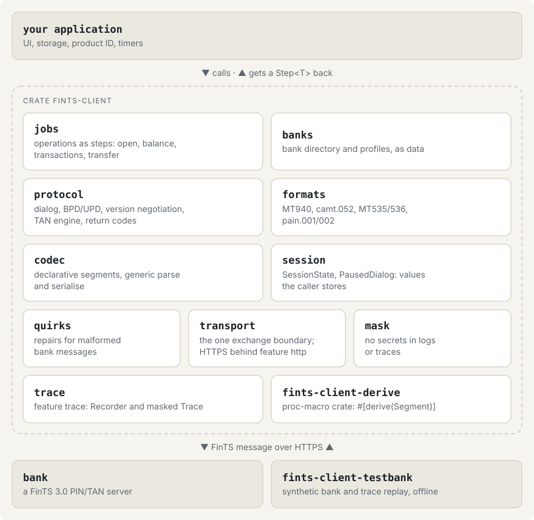

# fints-client

Rust client for **FinTS 3.0**, the online-banking protocol of German banks (formerly HBCI). Read balances, transactions and securities holdings, and send SEPA and instant transfers with the payee name check (Verification of Payee). PIN/TAN only.

[](https://crates.io/crates/fints-client)
[](https://docs.rs/fints-client)
[](LICENSE)


- **Tested live (November 2026):** DKB, comdirect, Consorsbank. Other banks: [see below](#tested-banks).
- **You need:** your own FinTS product ID ([below](#product-id)).
- **Status:** 0.1, stable in use. Breaking changes come only with a new minor version and are listed in the [CHANGELOG](CHANGELOG.md).

## Why fints-client

- **Steps, not callbacks.** Every operation returns `Done`, `NeedTan` (a typed TAN or an app approval) or a payee-check step, with a resume handle. The library never blocks, sleeps or calls back, so it fits a GUI, a server or a CLI.
- **You own the state.** Session state, and even a dialog paused at a TAN prompt, are plain serialisable values. The library writes no files, and a restart in the middle of an app approval loses nothing.
- **Bank quirks are data.** One engine reads each bank's own parameters; a bank that needs more gets a small profile, not a code path.
- **No secrets in logs.** PIN, TAN, user ID and account identifiers are masked at the transport layer.
- **Develop without a bank.** A synthetic test bank runs on your machine with app approval, typed TANs and the payee check, so your app can be built and tested before it ever logs in to a real account. ([Try it](#try-it-without-a-bank).)
- **Masked traces and replay.** One command records a real dialog with PIN, names, IBANs and amounts masked as it is written, prints it as a readable table, and replays it offline as a regression test. ([Adding a bank](#adding-a-bank).)

## Product ID

Banks answer only clients registered with the Deutsche Kreditwirtschaft (DK). Each registered product gets a product ID that goes into every message, and **fints-client ships with none**: an ID belongs to the product that uses it, not to the library. Register your app at [fints.org](https://www.fints.org/de/hersteller/produktregistrierung) and pass the ID to `BankClient::new`. Until then you can run everything against the [test bank](#try-it-without-a-bank), which accepts any ID.

## Quick start

```sh
cargo add fints-client
cargo add tokio --features full
```

```rust
use fints_client::jobs::{self, BankClient, Credentials, Step, TanKind};
use fints_client::{bank_by_blz, jiff::Timestamp, Pin, ProductId, SessionState, UserId};

let config = bank_by_blz("12030000").expect("BLZ in the bank directory"); // DKB
let client = BankClient::new(config, ProductId::new("YOUR-PRODUCT-ID"));
let user = UserId::new("user");
let creds = Credentials::new(user.clone(), Pin::new("pin"));
let state = SessionState::new(&client.config().blz, &user); // or SessionState::from_json(stored)

// Open the dialog. A bank that wants a TAN answers `NeedTan`.
let (mut dialog, mut step) = jobs::open(&client, &creds, &state).await?;
let opened = loop {
    match step {
        Step::Done(done) => break done.value,
        Step::NeedTan(challenge, resume) => {
            println!("{}", challenge.challenge);
            step = match challenge.kind {
                // App approval: wait as long as the bank asks, then ask once.
                TanKind::Decoupled { .. } => {
                    if let Some(at) = challenge.not_before {
                        let wait = at.duration_since(Timestamp::now());
                        tokio::time::sleep(wait.try_into().unwrap_or_default()).await;
                    }
                    dialog.poll(resume).await?
                }
                // chipTAN, smsTAN, photoTAN: the user types the TAN.
                TanKind::Typed { .. } => dialog.submit_tan(resume, &read_tan()).await?,
            };
        }
        _ => unreachable!("only a transfer pauses on its payee check"),
    }
};

let account = opened.accounts[0].account()?;
if let Step::Done(balance) = jobs::balance(&mut dialog, &account).await? {
    println!("{:?}", balance.value);
}
let state = dialog.end().await?;
std::fs::write("state.json", state.to_json()?)?; // encrypt this in a real app
```

`read_tan()` stands for your own prompt. The BLZ (Bankleitzahl) is the German bank code, characters 5 to 12 of the IBAN. [`examples/sync_accounts.rs`](examples/sync_accounts.rs) is the complete version: choosing a TAN method, transactions, storing the state and freezing a dialog across a restart.

### Try it without a bank

In a clone of the repository, start the synthetic test bank (it is not published on crates.io):

```sh
cargo run -p fints-client-testbank --bin fints-testbank -- --tan decoupled
```

and in a second terminal run the example against it:

```sh
FINTS_BLZ=12345678 FINTS_USER=testuser1 FINTS_PIN=test-pin-1 FINTS_PRODUCT_ID=TEST \
  cargo run --features testbank --example sync_accounts
```

[testbank/README.md](testbank/README.md) has the other TAN modes and bank models.

### Try it with your bank

Before writing any code, check that fints-client works with your bank, in a clone of the repository:

```sh
scripts/try-bank.sh sparkasse köln   # find your bank's BLZ
scripts/try-bank.sh 37050198         # log in, read every account, print a summary
```

It asks for your product ID, user ID and PIN with hidden input, only reads, and keeps a masked trace of the dialog on your machine. [Adding a bank](#adding-a-bank) explains the summary and how to report it.

## What it can do

| Operation | Function | FinTS |
|---|---|---|
| Accounts and what each one allows | `jobs::open`, `Dialog::capabilities` | UPD, BPD (the bank's user and bank parameters) |
| Balance | `jobs::balance` | HKSAL |
| Transactions, booked and pending, with SEPA fields | `jobs::transactions` | HKCAZ (camt.052), HKKAZ (MT940, MT942) |
| Holdings of a securities account (depot) | `jobs::holdings` | HKWPD (MT535) |
| Depot transactions | `jobs::depot_transactions` | HKWDU (MT536) |
| SEPA transfer, instant transfer | `jobs::transfer` | HKCCS, HKIPZ, pain.001 |
| Payee check (Verification of Payee) | part of `jobs::transfer` | HKVPP, HKVPA, pain.002 |
| TAN: app approval, typed TAN, photoTAN image, flicker code (passed through for you to render) | `Dialog::poll`, `Dialog::submit_tan` | HKTAN 5 to 7 |
| Pause a dialog and resume it in a new process | `Dialog::freeze`, `Dialog::thaw` | |

**Not supported:** HBCI chip cards and RDH keys, standing orders, scheduled transfers, direct debits, statement PDFs and the postbox, the savings banks' proprietary credit-card bookings and depot history. No UI and no storage: those are yours.

Cargo features: `http` (default, HTTPS transport with reqwest and rustls; without it you supply the transport), `trace` (masked recordings), `testbank` (registers the local test bank as a bank) and `tooling` (the protocol internals).

## Tested banks

| Bank | Login | Accounts | Depot | Transfer | Payee check |
|---|---|---|---|---|---|
| DKB | ✅ | ✅ | ? | ✅ | ✅ |
| comdirect | ✅ | ✅ | ✅ | ✅ | ✅ |
| Consorsbank | ✅ | ✅ | ✅ | ✅ | — |

✅ ran live in November 2026, ? not yet tested, — the bank does not offer it over FinTS. Accounts means balance and transactions of every account the bank lists with an IBAN; a transfer means one 1.00 EUR SEPA transfer. What each bank does differently is written down in [docs/banks.md](docs/banks.md). ING has a profile that has never run.

Other banks are untested. The bank directory knows the server of about 1,700 bank codes, among them the Volksbanks, Deutsche Bank, Commerzbank and HypoVereinsbank, and fints-client follows the specification and each bank's parameter data, so many should work. One read-only run tells: see the next section.

## Adding a bank

FinTS banks differ in small ways, and a library can only learn them from real dialogs. fints-client is built around that:

- **Trace recording.** A recorder at the transport layer writes every message of a dialog to one JSON file, masked as it is written: no PIN, name, IBAN, amount or booking text.
- **A summary anyone can read.** Each trace prints as a table with one line per message: the orders sent, their versions and the bank's return codes. It shows what a bank accepted and where it refused, without any personal data.
- **Replay.** The test bank plays a trace back to the client offline, so a recorded bank becomes a regression test.
- **A synthetic test bank.** It checks every request strictly and can be told to behave like a recorded bank: its TAN rules, paging, payee check and error codes.

One script runs the whole check:

```sh
scripts/try-bank.sh --dry-run        # try the flow against the local test bank
scripts/try-bank.sh sparkasse köln   # find your bank's BLZ
scripts/try-bank.sh 37050198         # log in, read every account, record, replay
```

It needs your own [product ID](#product-id), asks for your user ID and PIN with hidden input, only reads, and prints the summary table. Open a [bank report](https://github.com/cgrossde/fints-client/issues/new?template=bank-report.yml) with that table, whether the run worked or failed, and attach the trace file if you like: it holds no PIN, name, IBAN, text or amount, only the bank's messages and how many bookings of which kind you have, with their dates moved by a few days. [docs/adding-a-bank.md](docs/adding-a-bank.md) has the details.

## How it is built

[](https://cgrossde.github.io/fints-client/)

One crate, layers pointing downwards only: about 20,000 lines of library code, with 88 segment versions declared as Rust structs by a derive macro. The rest of the repository is tests (over 900), the synthetic test bank and replay fixtures. [docs/architecture.md](docs/architecture.md) explains each layer, the [interactive architecture page](https://cgrossde.github.io/fints-client/) lets you click through the components and three typical flows, and [docs/README.md](docs/README.md) lists every document from overview to detail.

## Inspired by

- **[fints-rs](https://github.com/floffel/fints-rs)** (Rust, MIT): fints-client began as a fork of it and has since been rewritten. The caller-driven dialog with state handed back to the caller comes from there.
- **[hbci4java](https://github.com/hbci4j/hbci4java)** (Java, LGPL): the idea that bank quirks belong in data.
- **[python-fints](https://github.com/raphaelm/python-fints)** (Python, LGPL): declarative segment definitions with one generic codec, and TAN and payee check as returned values.

From the two LGPL projects only ideas were taken, no code, tests or data; everything else was written from the FinTS specification and observed bank behaviour.

## Contributing

The most useful contribution is a bank: run [`scripts/try-bank.sh`](scripts/try-bank.sh) and send the summary. For code, read [CONTRIBUTING.md](CONTRIBUTING.md). Report a security problem as [SECURITY.md](SECURITY.md) describes.

## Licence

[MIT](LICENSE)
