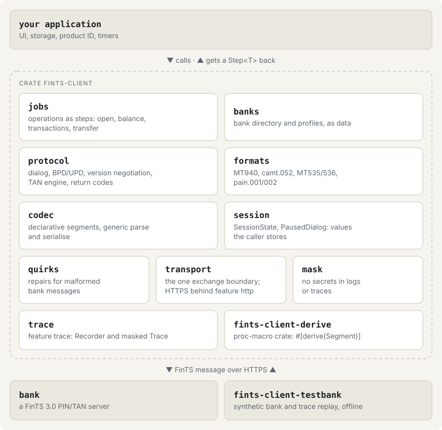
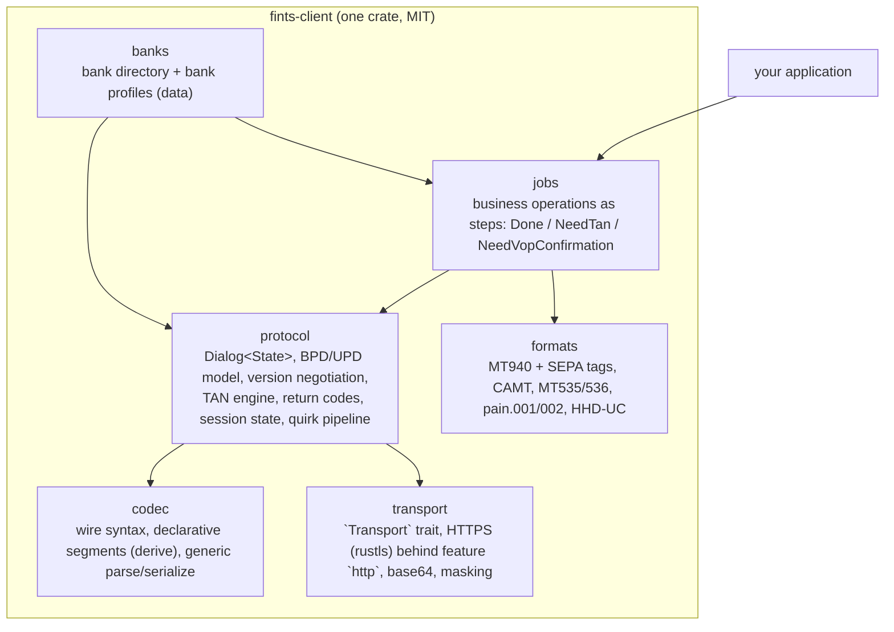

# Architecture

How fints-client is built, from the layers down to the rules each one follows. Start here; each section links to the design document with the details. Bank behaviour is in [banks.md](banks.md), and [architecture.html](architecture.html) shows the same structure as an interactive page.



## 1. Goals and constraints

**What the library does**
- Reads accounts, balances, booked and pending transactions, holdings and depot transactions.
- Sends a SEPA transfer and an instant transfer with the payee check (Verification of Payee, VoP).
- Takes a new segment version or a bank quirk without a change to the protocol layer.

**Constraints**
- **MIT throughout.** Apps using the library may be closed source. No LGPL code or LGPL-derived data enters the crate ([AGENTS.md](../AGENTS.md), "Clean room").
- **A library, not an app.** No CLI, no server, no storage. The host application supplies the user interface, the storage and the FinTS product ID (banks accept only registered products).
- **The caller owns all state.** System ID, BPD, UPD, TAN settings and paused dialogs are plain, versioned data that the caller stores per connection (one login at one bank). The library writes no files of its own.
- **Toolchain.** Edition 2024, developed on current stable, MSRV 1.92 (CI also builds with it).
- **Time.** `jiff` with default features off (`std`, `serde`, and the system zone lookup for the local wall clock only). The API has no named time zones: Formals `tim` is the local time of the sending system, and the XML formats carry fixed offsets. No `chrono`.
- **No secrets or identifiers in logs.** PIN, TAN, user ID, system ID and account identifiers are masked at the transport layer.
- **No bank contact from automated tests.** A human runs every command that contacts a bank; tests and CI run offline.

## 2. Layers



Cargo features: `http` (default) provides `HttpTransport` with reqwest and rustls, so without it a caller supplies its own `Transport`. `HttpTransport` times out after 60 s (`HttpTransport::with_timeout`) with the retryable `FinTSError::Timeout`; other failures are `FinTSError::Transport { kind }` (`Dns`, `Connect`, `Tls`, `Io`, `Decode`, `Config`). Quirks and the masked trace run at the single `transport::exchange` boundary, so a custom transport cannot skip them. Without `http`, a dialog without a transport fails with a `Transport` error of kind `Config`. `trace` adds the masked `Recorder`; `testbank` registers the local synthetic bank.

Each box is a module of the one crate; dependencies only point downwards, so each layer is testable alone. The derive macro needs a proc-macro crate of its own (`fints-client-derive`), published alongside. Further splits wait until a layer is useful on its own.

### 2.1 `codec`: declarative segments, in Rust

- **Wire syntax:** tokenizer, `?` escaping, `@len@` binary data, segment headers. Panic-free on any input (property tests).
- **Declarative segments.** One struct per segment version, with a derive macro that generates both directions:

  ```rust
  #[derive(Segment)]
  #[segment(code = "HKSAL", version = 7)]
  pub struct HkSal7 {
      pub account: Kti1,               // Kontoverbindung international
      pub all_accounts: Jn,
      #[de(max = 4)]  pub max_entries: Option<Num>,
      #[de(max = 35)] pub touchdown: Option<An>,
  }
  ```

  A new segment version is a dozen declarative lines, not a builder plus a parser. Lengths are `#[de(max = n)]` / `#[de(len = n)]`, repetition `#[de(min_count = l, max_count = m)]` on a `Vec<T>`, optional elements `Option<T>`; the attribute reference and a worked example are in [codec.md](codec.md). Written from the FinTS specification of the Deutsche Kreditwirtschaft.
- **Parse what you can, keep the rest.** An unknown or broken segment becomes `RawSegment` with an error attached. It doesn't fail the message, but it is reported to the caller and in the dump, never just logged (a warning alone is not enough).
- **Exact wire tests** per segment version, and property tests over the parser.

### 2.2 `protocol`: dialogs, parameters, TAN engine

- **Typestate dialog, internal.** `protocol::Dialog<New | Synced | Open | TanPending>` keeps the login state in the type system, but only the library sees it. Callers get `jobs::Dialog`, one type with a runtime phase (`Open`, `Paused`, `Ended`), because a paused or dropped dialog has to survive a restart as a value.
- **A typed BPD/UPD model.** Parameter segments are parsed into types, not kept raw. Job limits, SEPA formats and VoP parameters become available to the job layer.
- **Version negotiation.** The highest version both the BPD and the codec offer, or an error naming both sides. No clamping.
- **The TAN engine.**
  - HKTAN process 4, S (decoupled) and 2.
  - Decoupled polling is the caller's: the library sends one HKTAN process S per `Dialog::poll`, enforces the bank's maximum poll count (`DecoupledMaxPolls` without sending; on a transfer `PaymentOutcomeUnknown`, since the bank may still execute it), and tells the caller when to ask next (`TanChallenge::not_before`: the arrival of the bank's answer plus the HITANS v7 wait). It never sleeps, holds no timer or cancellation token and calls no callback; timeout and cancellation are the caller's (`Dialog::cancel`). 3957 ("wait for the push message") without 0020 counts as still pending like 3956. When the bank says `auto_polling_allowed = false` the caller must not poll on a timer.
  - **TAN requirement = HIPINS, then bank-profile overrides, then one retry with HKTAN on 9075.** Consorsbank's HIPINS wrongly says "no TAN" for HKSAL/HKKAZ ([banks.md](banks.md)). Trusting HIPINS fails there. The PIN-only method 999 sends no HKTAN. An order missing from HIPINS sends no HKTAN either (PIN/TAN data dictionary, HIPINS); the one retry on 9075 covers a bank that wants it. A retry that gets no error teaches the code to the session state. On 9075 together with 9800 the dialog is gone: the client learns the code, returns the error and sends nothing again.
- **Message rules (PIN/TAN).**
  - The HNVSK security function is always `998` (PIN/TAN B.9.8) and the security party in HNSHK and HNVSK is `1` (Security D, PIN/TAN F.2.2).
  - HNSHA without a TAN leaves the TAN element out (Formals H.1.5).
  - The decoupled status poll uses HKTAN process `2` with HKTAN 5 and 6, and process `S` only with HKTAN 7 (PIN/TAN B.5.2). With HKTAN 5 the segment code stays HKTAN, which deviates from PIN/TAN E.1.5 a.
- **Response checks.** A size in HNHBK that does not match the message is logged, not enforced: banks may misreport it. UTF-8 text in an ISO 8859-1 answer is a notice (`ClientWarning::Utf8TextInLatin1`), not an error.
- **Typed return codes.** `ReturnCode` keeps every code line (code, text, scope, reference element, parameters) and derives a `Kind`; class 9 codes map to a `Category` (credentials, TAN, system ID, temporary, unsupported, client fault, rejected) behind `FinTSError::Bank(BankError)` and `FinTSError::kind()`; one error is selected by a fixed rule (a specific cause before the signature error 9340, before the generic 9010/9050/9800) and keeps all codes. Warnings and other non-error codes the protocol does not consume reach the caller as `Notice`s on `Completed::notices` of the `Done` step, including those of messages sent before a `NeedTan`. A `Notice` says which dialog (sync or job) and which segment it answers, and is not deduplicated; a `Notice::Client` carries a warning the client raised itself (UTF-8 text in an ISO 8859-1 answer), never a bank code.
- **Session state** as one serialisable value: system ID, BPD, UPD, TAN method and TAN medium (`SessionState`). It also holds the security functions the bank last allowed (3920), the previous user ID after a 3072, and the orders learned to need HKTAN (9075). The caller keeps one state per login and writes back the state that `Dialog::end` or `jobs::synchronise` returns after every dialog. That avoids repeated round trips and TANs:
  - **No sync dialog.** `SessionState::can_skip_sync` is true once the state holds an assigned system ID and a BPD, and `jobs::open` then skips HKSYN.
  - **No BPD/UPD download.** HKVVB announces the cached BPD and UPD versions (Formals C.3.1.3), so the bank only sends parameters newer than those (C.3.2.2, C.3.2.3).
  - **The same device to the bank.** The system ID identifies the client installation (Formals C.8). A new one looks like a new installation, so a bank that answered 3076 to the old one may ask for a login TAN again. No live run has tested this yet.
  - **No failed first attempt.** An order learned from a 9075 carries HKTAN from the first message on.
  - Whether a login or read needs a TAN stays the bank's decision. When it answers 3076 on HKTAN, the step is `Done` and no `NeedTan` comes (`Response::order_tan_challenge`). Several jobs on one `jobs::Dialog` share its login.

  A lost state costs a new sync dialog and a new system ID, so the next login looks like a first login.
- **Paused dialogs** (built). `Dialog::freeze` turns an open or TAN-waiting dialog into a `PausedDialog`, a self-contained value tagged `fints-client-paused/4` (dialog and message number, BPD/UPD, TAN selection, the pending job with its paging state, last message time) with `to_json`/`from_json`; it sends nothing and consumes the dialog, so no second copy can send the same message number. `PausedDialog::pending()` returns an `AnyResume` naming the job, and `Dialog::thaw(paused, &client, &creds)` rebuilds the dialog in a new process, checking BLZ, URL and user ID. Some banks require the TAN in the same dialog as the order; this is what makes that work across restarts. `expires_at()` (the bank's HIBPA timeout, capped by the challenge validity) is informational only: thaw never refuses on time and the bank's answer decides. The value is versioned plain data, not a language-specific object dump, and integrity-protected by the caller's storage; `examples/sync_accounts.rs` shows the round trip.
- **Quirk pipeline.** A `Quirk` repairs a message at one of three stages: the raw message, the unwrapped envelope, the clear text. The default chain holds four tolerant-parsing repairs (`src/quirks/tolerant.rs`: missing message reference, empty or `0` header version, status segment order, segment numbering). A further repair is written when a bank needs one, from the specification and the observed message.

### 2.3 `jobs`: business operations as steps

Free functions over an open `jobs::Dialog`. Every operation returns a step, not a callback:

```rust
pub enum Step<T> {
    Done(Completed<T>),                          // value + notices
    NeedTan(TanChallenge, Resume<T>),            // typed TAN, decoupled (app), photoTAN, flicker
    NeedVopConfirmation(VopConfirmation, Resume<T>), // payee check is not a clean match: RVMC (+ registered name), RVNM, RVNA
    VopPending(VopWait, Resume<T>),              // payee check not finished (PDNG), poll again
}
```

How to answer each variant:

- `Done`: the value and the bank's notices; nothing to answer.
- `NeedTan`: `dialog.submit_tan(resume, tan)` for a typed challenge, `dialog.poll(resume)` for a decoupled one (at or after `TanChallenge::not_before`). A wrong typed TAN the bank keeps the order for (9941 alone) gives `NeedTan` again with `TanChallenge::rejected` (the bank's code and text, attempts left); otherwise a typed error ([jobs-step-design.md](jobs-step-design.md) §2).
- `NeedVopConfirmation`: show the result and the bank's explanation text, then `dialog.confirm_vop(resume)` to send the order anyway (a `NeedTan` follows) or `dialog.cancel(resume)` to drop it (`Cancelled::NothingSent`: the bank executes nothing without the execution order).
- `VopPending`: `dialog.poll(resume)` at or after `VopWait::not_before`, which asks the bank for the next part of the result.

- `jobs::open(&BankClient, &Credentials, &SessionState)` gives the dialog and a `Step<Opened>`; the sync dialog is skipped when the state allows, and the state's TAN method applies when the bank allows it. `jobs::synchronise` (same arguments, `Result<Completed<SessionState>>`: the state and the dialog's notices) runs the sync dialog alone, without a login or TAN, so the caller can choose among the allowed TAN methods before `open`. `BankClient` is the bank's `BankConfig`, the product ID and the transport; the bank's login mode (`InitMode`, ING's PIN-only login) is a config field, not a branch on the BLZ.
- `Opened { accounts: Vec<AccountInfo>, tan_methods, allowed_security_functions, selected_tan_method }`. `AccountInfo` is one UPD entry: `key: AccountKey`, `iban: Option<Iban>`, `bic` (the bank's when the UPD has none), `number`, `subaccount`, `owner`, `product_name`, `currency`, `account_type` (Kontoart), `class`, `limit`, `allowed: Vec<JobKind>`; `account()` gives the `Account` the jobs take. `AccountKey` is the account's identity across logins: the KTV (its own BLZ, number without leading zeros, subaccount), or IBAN and subaccount for an entry without number; its string form (`20041155/301/01`, `iban:DE…`) round-trips through `Display`/`FromStr` and serde. Jobs and `Capabilities` find the UPD entry of an `Account` by this key, subaccount included, so accounts that share IBAN and number (comdirect) stay apart.
- The job functions (`balance`, `transactions`, `holdings`, `depot_transactions`) take the dialog and an `Account`. Touchdown paging runs inside the job; a TAN on any page pauses it with the pages so far. A job either completes or fails: no error is turned into an empty result (a failed paging run returns no partial data).
- `dialog.submit_tan(resume, tan)` answers a typed challenge, `dialog.poll(resume)` sends one status request for a decoupled one, `dialog.cancel(resume)` drops the job and says what is left at the bank: `Cancelled::NothingSent`, or for a transfer waiting for its TAN `Cancelled::OrderSubmitted { end_to_end_id, message_id }` (a late approval in the app may still execute it). A transfer ends with a receipt, a class 9 rejection, or `PaymentOutcomeUnknown`: after a message carried the order or its TAN, every other error is an unknown outcome. Job futures are not cancel-safe: a future dropped mid-request ends the dialog, and when it carried a payment the next call returns `PaymentOutcomeUnknown` with its IDs once. The dialog holds the paused job (`Paused`): any other job returns `DialogPaused`, a ticket for another job `WrongResume`; after the bank ends the dialog or a request is lost every call returns `DialogEnded`. `dialog.end()` returns the updated `SessionState`; `dialog.session_state()` returns the same state as a snapshot at any time, sends nothing and changes nothing, so the host can store it after `open` and after each job and a crash keeps a freshly assigned system ID.
- The library never calls back and never waits: a host maps `NeedTan`, `NeedVopConfirmation` and `VopPending` onto its own prompts.

| Operation | Segments | Notes |
|---|---|---|
| Accounts | UPD, HKSPA | all accounts in one dialog; `Opened::accounts` from the UPD, one dialog for every job (HKSPA is not built yet) |
| Balance | HKSAL | booked, pending, available, credit line from HISAL (Consorsbank sends available and credit line, DKB and comdirect don't) |
| Transactions | HKKAZ (MT940/MT942), HKCAZ (CAMT.052) | prefer CAMT where offered (DKB: structured fields complete); MT940 needs SEPA tag parsing (Consorsbank). `Statement` has the booked entries, `Pending` (`Reported` only for a complete list: an MT942 whose `:90D:`/`:90C:` do not match its bookings is `Unreadable`; `NotSent` without a pending part) and `pending_created_at`, the MT942 creation time (`:13D:`/`:13:`) |
| Holdings, depot transactions | HKWPD (MT535), HKWDU (MT536) | own parsers; MT535 with ISIN and WKN, acquisition date and price |
| Transfer, instant transfer | HKCCS, HKIPZ + pain.001 | the specification (HKCCS, HKIPZ) |
| Payee check | HKVPP before the order, HKVPA | the specification: VoP flow, polling and pain.002 results |
| Capabilities | BPD + UPD | per account, which operations and formats the bank offers (negotiated version or mismatch, camt or MT940), the UPD allowance shown but never blocking: `Dialog::capabilities`, `SessionState::capabilities` |

### 2.4 `formats`

- **MT940 with repairs.** Pagination, separators, `:86:` overflow, 29 February. Booking date from the entry date and value date from `:61:`. Year correction across New Year.
- **SEPA tags from `:86:`.**
  - Built (`formats::tag86`): join the 27- or 65-character lines without separators, then split EREF, KREF, MREF, CRED, DEBT, SVWZ, ABWA, ABWE, PURP and the rest into `Transaction` fields (`purpose` is the SVWZ value, as in CAMT). The whole `:86:` stays in `raw["tag86"]`.
  - Built: `NOTPROVIDED`, `NONREF` and empty values are absent in every reference field of MT940 and CAMT, including the `:61:` customer reference (learned at Consorsbank). The value as sent stays in `raw`.
  - This belongs here, not in the caller, since MT940 carries this text unparsed.
- **CAMT.052** with ultimate parties, purpose code and mandate. The bank's reference is kept in `bank_reference`. `Transaction::booking_id` is set only where the profile names a unique and stable reference (`BookingIdSource`): at DKB the entry-level `AcctSvcrRef` of booked entries; pending entries get none, since whether a booking keeps its reference from pending to booked is **unverified**. MT940 never sets it (the `:61:` reference is often `NONREF` or repeated), and a reference on two entries of one statement is dropped from both.
- **MT535 and MT536** (own parsers).
- **pain.001 builder and pain.002 parser** for transfers and payee-check results.
- **HHD-UC decoding** for photoTAN images and flicker codes.

### 2.5 `banks`: quirks as data, not code

One generic engine; each bank is a profile, a serialisable value on the config, not a Rust type of its own:

- `BankConfig { name, blz, bic, url, profile }`. `bank_by_blz(blz)` joins the directory entry (name, BIC and URL per BLZ, generated from `data/fints_institutes.csv` by `build.rs`) with the profile from `src/banks/table.rs`, generic for a code without an entry. `with_url` replaces the URL and keeps the profile.
- Selection is by explicit BLZ list, never by URL or range: one host can serve several banks (comdirect has eight codes, Consorsbank two). A test checks that every directory code sharing a profiled bank's URL is listed.
- `BankProfile { id, init, tan_overrides, user_id, booking_id }`. An entry needs a trace or a [banks.md](banks.md) observation where the generic rule gives the wrong result.

| Profile field | Holds | Set for ([banks.md](banks.md)) |
|---|---|---|
| `id` | name for logs, traces and tests | DKB, comdirect, Consorsbank, ING |
| `init` | `InitMode::Direct { security_function }`: business dialog without a sync dialog | ING (**unverified**) |
| `tan_overrides` | per order, `Always` or `Never`, beats HIPINS | none: the retry on 9075 learns it (Consorsbank, live) |
| `user_id` | `UserIdRule`: 9 or 10 ASCII digits get `001` appended by the library | Consorsbank |
| `booking_id` | `BookingIdSource`: which reference is unique and stable and becomes `Transaction::booking_id`; `CamtEntryAcctSvcrRef` takes the entry-level camt `AcctSvcrRef` of booked entries | DKB |

Generic, driven by the bank's own parameters, so no profile field:

- BIC: filled from the directory when the UPD has none (DKB).
- KTI form: national parts when HISPAS allows them (Consorsbank, DKB).
- Account class: Kontoart first, else depot by allowed jobs (HKWPD and none of HKSAL, HKKAZ, HKCAZ), else unknown (`AccountInfo::class`, comdirect, Consorsbank).
- Account identity: `AccountKey` from the KTV, subaccount included (comdirect).
- UPD storage: version 0 is used for the dialog and not stored.
- Job versions, CAMT or MT940, HKTAN per order, decoupled or typed TAN: from the BPD.

The caller's job, since the library reports what the bank sends: reclassifying accounts by product name (DKB Tagesgeld arrives as a current account), skipping accounts it does not want (DKB credit card), a display fallback for thin bookings.

### 2.6 Public API and callers

- The public API is the `jobs` layer plus the state types: `jobs::open` a session from stored `SessionState`, read the accounts from `Opened`, run job functions on the `jobs::Dialog`, answer each `NeedTan` with `submit_tan` or `poll`, and take the updated state back from `Dialog::end`. A paused dialog is a value too (`Dialog::freeze`, `thaw`). The crate root re-exports the types those signatures name (state, `Step` and resume types, config, errors, domain types) and `jiff`, whose dates appear in them, so a caller can match the version. `codec`, `protocol` and the module `types` (the crate root re-exports the domain types out of it) are behind the cargo feature `tooling` (off by default; the test bank, the examples and wire-level tests enable it). There is no other entry point: no combined fetch, no bank dispatch by BLZ (a caller looks up a `BankConfig` with `bank_by_blz`), no waiting helper.
- A capabilities query reports per account which operations and formats the bank allows, so callers can grey out what an account can't do.
- Every result carries the library's full record as raw data next to the typed fields, so callers can compare and debug without a new release.

## 3. How we know it works

1. **Unit level.** An exact wire string per segment version, property tests over every parser, synthetic fixtures for the statement formats.
2. **The test bank** (`testbank/`, [testbank/README.md](../testbank/README.md)). A synthetic FinTS bank that checks every request strictly and answers from a model: SCA exemptions, typed and decoupled TANs, paging, payments, the payee check, faults on the wire. End-to-end tests run against it in process, without a socket.
3. **Traces and replay** ([trace-tooling.md](trace-tooling.md)). A masked recording of a real dialog is replayed against the client offline. The replay compares the structure of every request with the recorded one, so a change in what the client sends to that bank fails a test.
4. **Bank profiles of the test bank.** Each tested bank has a hand-written model whose parameter data must agree with that bank's trace ([bank-profiles-design.md](bank-profiles-design.md)).

## 4. Design documents

| Layer | Document |
|---|---|
| `codec` | [codec.md](codec.md): how to add a segment, the derive attributes |
| `protocol` | [bpd-upd-design.md](bpd-upd-design.md), [version-negotiation-design.md](version-negotiation-design.md), [return-codes-design.md](return-codes-design.md), [session-state-design.md](session-state-design.md) |
| `jobs` | [jobs-step-design.md](jobs-step-design.md), [payments-design.md](payments-design.md) |
| `formats` | [formats-design.md](formats-design.md) |
| `banks` | [bank-profiles-design.md](bank-profiles-design.md), [banks.md](banks.md), [adding-a-bank.md](adding-a-bank.md) |
| tracing and the test bank | [trace-tooling.md](trace-tooling.md), [testbank/README.md](../testbank/README.md) |
